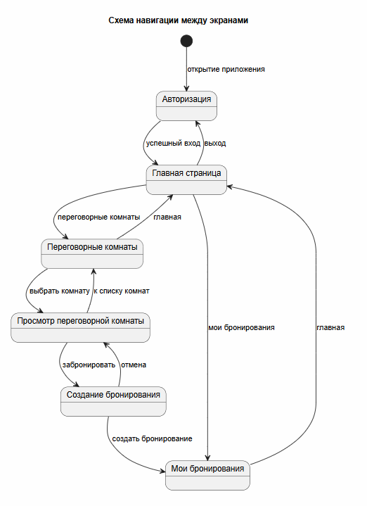
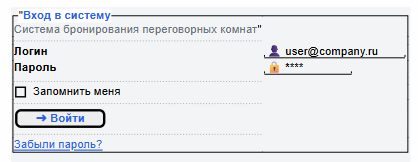
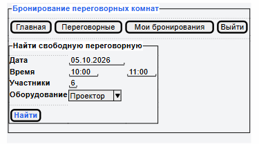
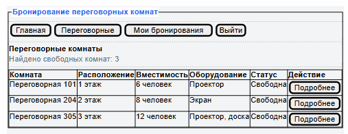
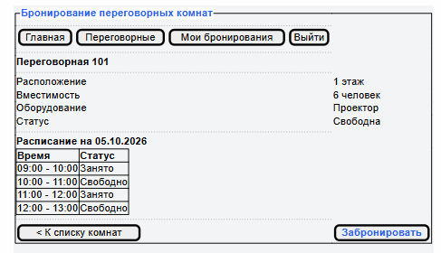
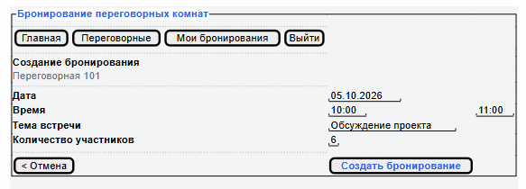
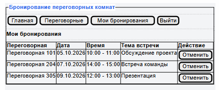

# Лабораторная работа №4

## Проектирование пользовательского интерфейса

**Предметная область:** система бронирования переговорных комнат.

## Цель работы

Изучить основные принципы проектирования пользовательских интерфейсов, разработать структуру экранов информационной системы, спроектировать навигацию и подготовить интерактивные или статические макеты страниц.

## 1. Структура пользовательского интерфейса

Пользовательский интерфейс системы состоит из экранов для поиска и просмотра переговорных комнат, создания и просмотра бронирований, а также отдельных разделов для администраторов.

| Экран | Назначение | Основные элементы | Действия пользователя |
|---|---|---|---|
| Авторизация | Вход пользователя в систему | Поля логина и пароля, кнопка «Войти» | Ввести данные и войти в систему |
| Главная страница | Быстрый поиск подходящей переговорной комнаты | Выбор даты, времени, количества участников и необходимого оборудования | Указать параметры и найти свободные комнаты |
| Переговорные комнаты | Просмотр списка переговорных комнат | Список комнат, вместимость, оборудование, статус, фильтры | Выбрать комнату и перейти к подробной информации |
| Переговорная комната | Просмотр информации о выбранной комнате | Название, расположение, вместимость, оборудование, расписание | Просмотреть информацию и перейти к созданию бронирования |
| Создание бронирования | Создание нового бронирования | Комната, дата, время начала и окончания, тема встречи, количество участников | Заполнить данные и создать бронирование |
| Мои бронирования | Просмотр собственных бронирований | Список бронирований, дата, время, комната, тема встречи | Просмотреть или отменить своё бронирование |
| Управление переговорными | Управление переговорными комнатами | Список комнат, данные о комнатах, оборудование, статус | Добавлять комнаты, изменять информацию, оборудование и статус доступности |
| Управление пользователями | Управление учётными записями | Список пользователей, роли и состояние учётной записи | Управлять пользователями и их ролями |

## 2. Навигация между экранами

После авторизации пользователь попадает на главную страницу. С главной страницы можно перейти к списку переговорных комнат или к разделу с собственными бронированиями.
При выборе переговорной комнаты из списка пользователь переходит на страницу с подробной информацией о ней. Оттуда можно перейти к созданию бронирования. После успешного создания бронирования открывается раздел «Мои бронирования».
С основных экранов предусмотрены переходы назад к предыдущим разделам. С главной страницы пользователь также может выйти из системы и вернуться на экран авторизации.



**Исходник:** [diagrams/src/navigation.puml](./diagrams/src/navigation.puml)

## 3. Прототипы экранов

Для основных экранов системы подготовлены прототипы, показывающие расположение элементов интерфейса без детальной визуальной проработки. Прототипы выполнены в формате Wiferame с помощью PlantUML Salt - позволяет хранить макеты в текстовом виде и легко вносить в них изменения.

### Авторизация

Экран содержит поля для ввода логина и пароля и кнопку входа в систему.



**Исходник:** [design/src/01-login.puml](./design/src/01-login.puml)

### Главная страница

На главной странице располагается форма поиска свободной переговорной комнаты. Пользователь может указать дату, время, количество участников и необходимое оборудование.



**Исходник:** [design/src/02-main.puml](./design/src/02-main.puml)

### Переговорные комнаты

Экран содержит список переговорных комнат с основной информацией о каждой комнате. Пользователь может выбрать необходимую комнату и перейти к её просмотру.



**Исходник:** [design/src/03-rooms.puml](./design/src/03-rooms.puml)

### Просмотр переговорной комнаты

На странице отображаются информация о выбранной комнате, её расположение, вместимость, оборудование и расписание бронирований. С этой страницы пользователь может перейти к созданию бронирования.



**Исходник:** [design/src/04-room.puml](./design/src/04-room.puml)

### Создание бронирования

Форма позволяет выбрать дату и время бронирования, указать тему встречи и количество участников. Перед созданием бронирования система проверяет занятость комнаты на выбранное время.



**Исходник:** [design/src/05-booking.puml](./design/src/05-booking.puml)

### Мои бронирования

Экран содержит список бронирований текущего пользователя. Для каждого бронирования отображаются переговорная комната, дата, время и тема встречи. Пользователь может отменить своё бронирование.



**Исходник:** [design/src/06-my-bookings.puml](./design/src/06-my-bookings.puml)

## 4. Принятые решения по организации интерфейса

Основные разделы системы доступны через единое меню. Пользователь может перейти к списку переговорных комнат и своим бронированиям с главной страницы.

Основной сценарий бронирования построен последовательно: пользователь открывает список переговорных комнат, выбирает нужную комнату, просматривает информацию о ней и переходит к созданию бронирования. Это позволяет выполнить основную операцию без лишних переходов между экранами.

Доступные пользователю функции зависят от его роли. В прототипах показаны основные экраны, используемые сотрудником. Функции управления переговорными комнатами и пользователями относятся к административной части системы и в представленные прототипы не включены.

## 5. Связь интерфейса с API

Пользовательский интерфейс не обращается к базе данных напрямую. Действия пользователя во Frontend приводят к отправке запросов к REST API, описанному в предыдущей лабораторной работе.

Например, получение списка переговорных комнат выполняется с помощью `GET /api/rooms`, а создание нового бронирования с помощью `POST /api/bookings`.

## Вывод

В результате работы спроектирован пользовательский интерфейс системы бронирования переговорных комнат, определена структура из 6 основных экранов и продумана навигация между ними. Также подготовлены схема навигации между экранами и прототипы основных страниц в формате Wireframe с помощью PlantUML Salt.

**Структура репозитория:**

```text
lab4/
├── README.md
├── diagrams/
│   ├── images/
│   │   └── navigation.png
│   └── src/
│       └── navigation.puml
└── design/
    ├── images/
    │   ├── 01-login.png
    │   ├── 02-main.png
    │   ├── 03-rooms.png
    │   ├── 04-room.png
    │   ├── 05-booking.png
    │   └── 06-my-bookings.png
    └── src/
        ├── 01-login.puml
        ├── 02-main.puml
        ├── 03-rooms.puml
        ├── 04-room.puml
        ├── 05-booking.puml
        └── 06-my-bookings.puml
```