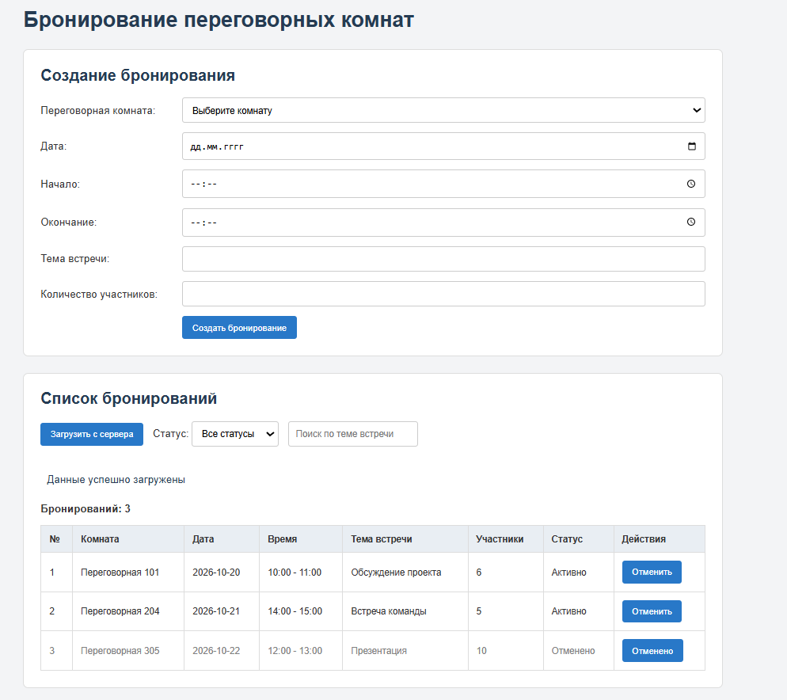
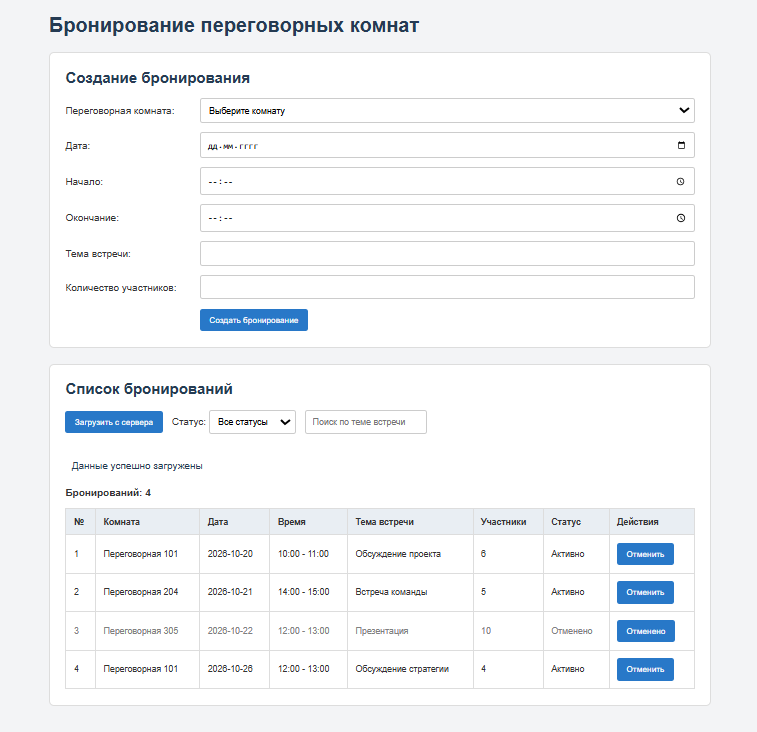
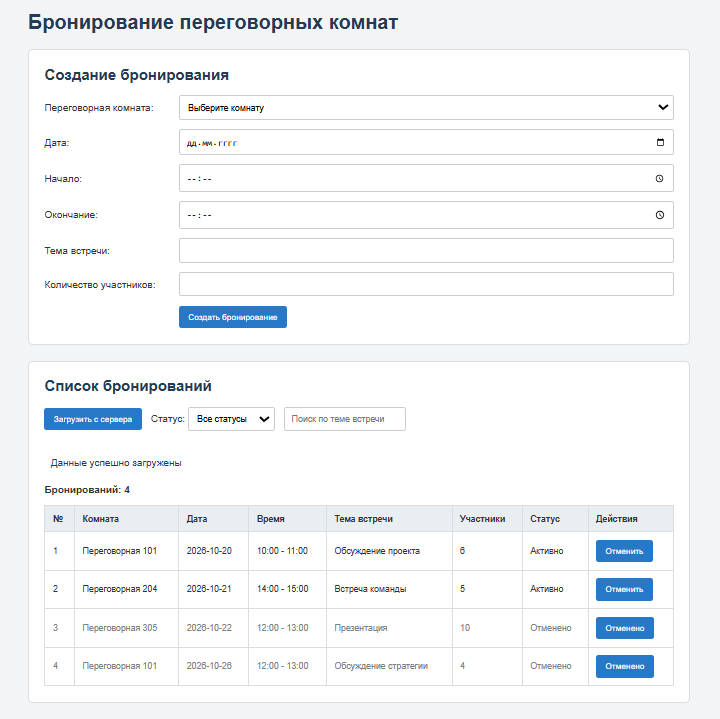
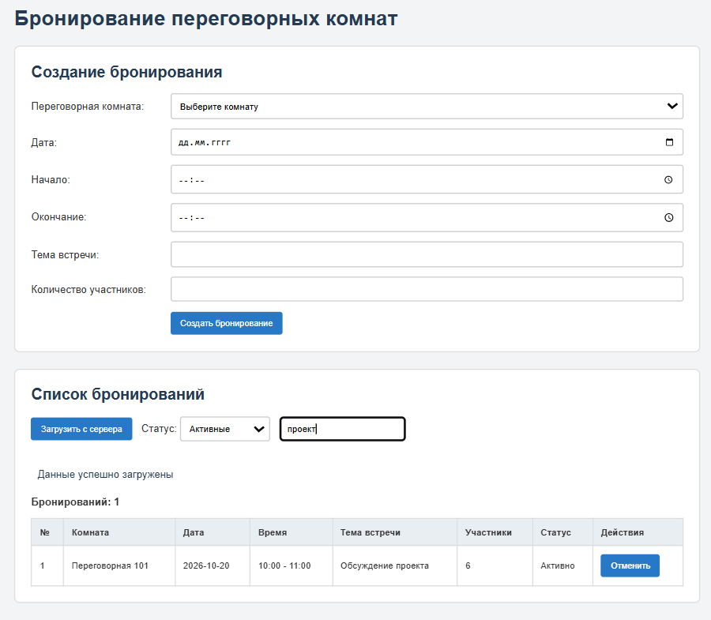
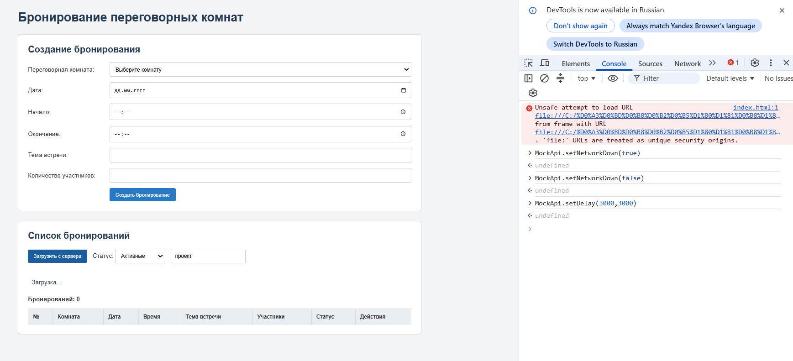
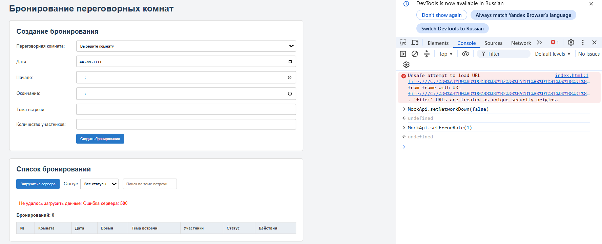
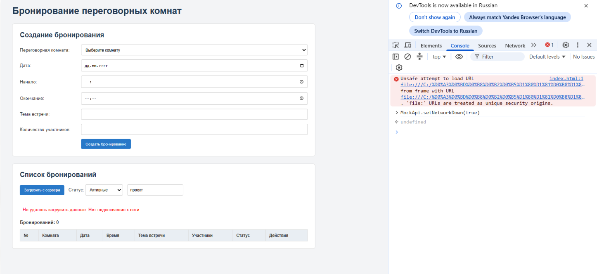

# Лабораторная работа №5

## Реализация клиентской логики

**Предметная область:** Система бронирования переговорных комнат.

## Цель работы

Изучить основы разработки клиентской части веб-приложений, реализовать обработку пользовательских событий, взаимодействие с сервером посредством асинхронных запросов и динамическое изменение содержимого веб-страницы с использованием JavaScript.

## Постановка задачи

На основе интерфейса системы бронирования переговорных комнат необходимо реализовать клиентскую логику, позволяющую пользователю создавать бронирования, просматривать их список, выполнять поиск и фильтрацию, а также отменять бронирования.

Для получения данных используется учебный сервер (mock API), который имитирует работу серверной части приложения.

## Реализация клиентской логики

### 1. Обработка пользовательских событий

В приложении реализованы обработчики следующих событий:

- `submit` для отправки формы создания бронирования;
- `click` для загрузки списка и отмены бронирования;
- `change` для фильтрации по статусу;
- `input` для поиска по теме встречи.

При отправке формы используется `event.preventDefault()`, чтобы страница не перезагружалась.

Перед созданием бронирования проверяются корректность времени, количество участников и отсутствие пересечений с существующими активными бронированиями.

### 2. Работа с DOM

JavaScript используется для изменения содержимого страницы без её перезагрузки.

При загрузке данных создаются строки таблицы с информацией о бронированиях. Для этого используются методы `document.createElement()`, `appendChild()` и свойство `textContent`.

После изменения данных обновляется количество отображаемых бронирований. Для отменённых бронирований изменяется оформление строки.

### 3. Асинхронные запросы

Для взаимодействия с учебным сервером используются `fetch`, `async` и `await`.

В приложении предусмотрены запросы:

| Запрос | Назначение |
|---|---|
| `GET /api/rooms` | Получение списка переговорных комнат |
| `GET /api/bookings` | Получение списка бронирований |
| `GET /api/bookings?status=active` | Получение активных бронирований |
| `GET /api/bookings?q=проект` | Поиск бронирований по теме встречи |

Учебный сервер реализован в файлах `mock-data.js` и `mock-api.js`. Он позволяет проверять работу запросов без отдельного backend-сервера.

### 4. Состояния интерфейса и обработка ошибок

При загрузке бронирований отображается сообщение «Загрузка...», а кнопка загрузки временно блокируется.

После получения ответа таблица обновляется. Если подходящих бронирований нет, пользователь получает соответствующее сообщение.

Для проверки обработки ошибок используются возможности учебного сервера:

- `MockApi.setDelay(3000, 3000)` для проверки задержки ответа;
- `MockApi.setErrorRate(1)` для имитации ошибки сервера;
- `MockApi.setNetworkDown(true)` для имитации отсутствия сети.

При возникновении ошибки выводится сообщение красным цветом. После завершения запроса кнопка загрузки снова становится доступной.

## Структура проекта

```text
lab5/
├── README.md
└── src/
    ├── index.html
    ├── css/
    │   └── styles.css
    └── js/
        ├── app.js
        ├── mock-api.js
        └── mock-data.js
```

Файл `index.html` содержит элементы интерфейса, `styles.css` отвечает за оформление страницы, `app.js` содержит обработчики событий и клиентскую логику, а файлы `mock-api.js` и `mock-data.js` используются для имитации работы сервера.


## Проверка работы

В ходе проверки приложения выполнены следующие действия:

1. Загружен список переговорных комнат и существующих бронирований.
2. Создано новое бронирование, которое появилось в таблице.
3. Выполнена отмена бронирования с изменением его статуса.
4. Проверена фильтрация бронирований по статусу.
5. Проверен поиск по теме встречи.
6. Проверено отображение загрузки при задержке ответа сервера.
7. Проверены сообщения об ошибках сервера и отсутствии сети.
8. После восстановления соединения проверена повторная загрузка данных.

### Результаты проверки

**1. Загрузка списка бронирований**

После открытия страницы данные загружаются с учебного сервера и отображаются в таблице.



**2. Создание бронирования**

После заполнения формы новое бронирование добавляется в список без перезагрузки страницы.



**3. Отмена бронирования**

При нажатии кнопки «Отменить» статус бронирования изменяется на «Отменено».



**4. Фильтрация и поиск**

При выборе статуса и вводе текста поиска в таблице остаются только подходящие бронирования.



**5. Задержка ответа сервера**

При задержке ответа отображается сообщение «Загрузка...».



**6. Ошибка сервера 500**

При возникновении ошибки сервера приложение выводит сообщение об ошибке и позволяет повторить загрузку.



**7. Отсутствие подключения к сети**

При отсутствии подключения приложение сообщает о невозможности загрузить данные.



## Вывод

В результате лабораторной работы реализована клиентская логика системы бронирования переговорных комнат. С помощью JavaScript добавлены обработка пользовательских событий, изменение содержимого страницы и получение данных через асинхронные запросы. Также реализованы поиск, фильтрация, создание и отмена бронирований, отображение загрузки и обработка ошибок.