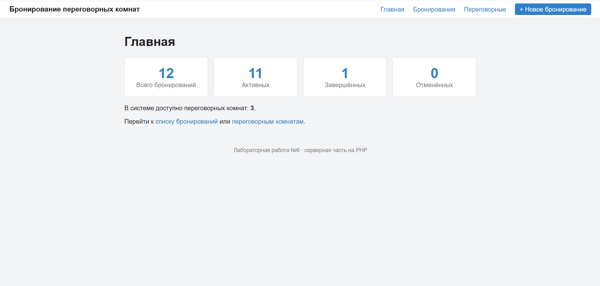
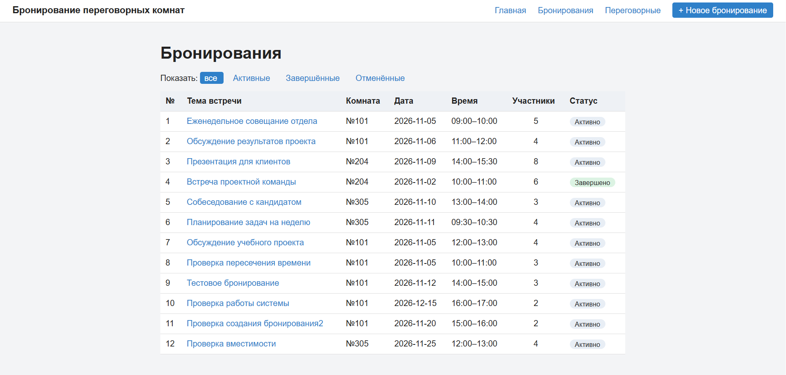
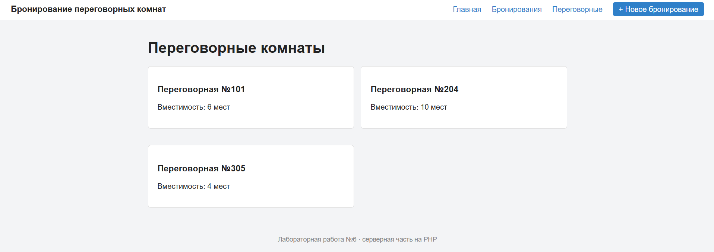
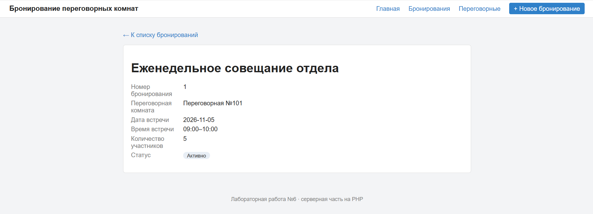
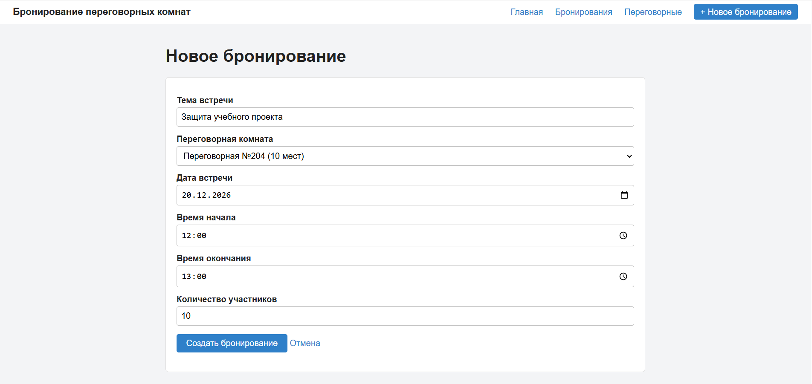
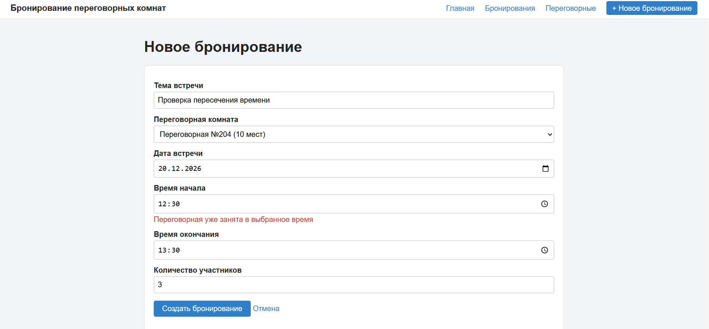
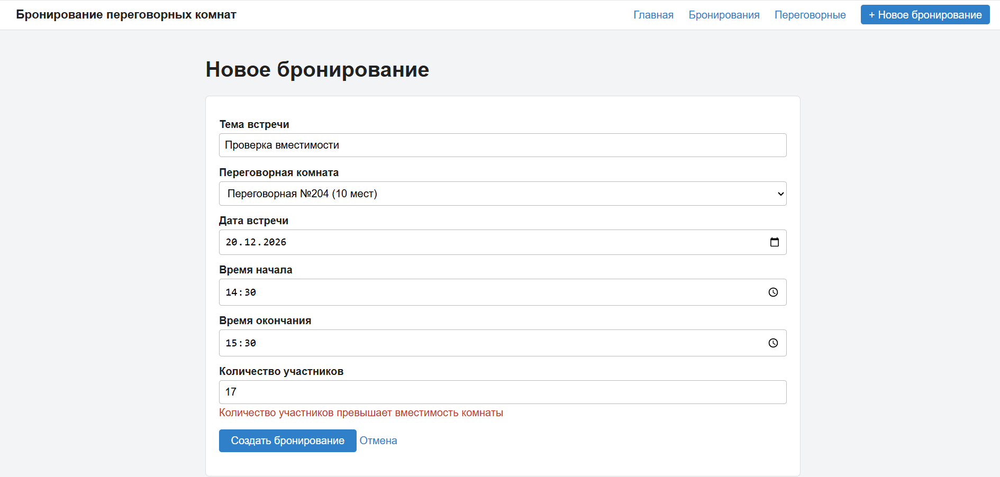

# Лабораторная работа №6

## Разработка серверной части веб-приложения на PHP

**Предметная область:** система бронирования переговорных комнат.

## Цель работы

Изучить основы разработки серверной части веб-приложения на PHP, реализовать обработку HTTP-запросов, маршрутизацию, работу с данными и проверку пользовательского ввода.

## Описание приложения

Разработана серверная часть системы бронирования переговорных комнат.

Приложение позволяет:
- просматривать список переговорных комнат и их вместимость;
- просматривать бронирования и сведения о каждом из них;
- создавать новые бронирования;
- фильтровать бронирования по статусу;
- проверять корректность введённых данных;
- предотвращать бронирование занятой переговорной;
- проверять соответствие количества участников вместимости комнаты.

## Структура приложения

Проект организован с разделением на контроллеры, модели и представления.

- `Controllers` — обработка запросов и проверка данных.
- `Models` — получение и сохранение данных.
- `Views` — формирование HTML-страниц.
- `routes/web.php` — маршруты приложения.
- `storage` — хранение данных в JSON-файлах.
- `public` — точка входа и CSS-файл.

Для хранения данных используются `rooms.json` и `bookings.json`.

## Реализованные маршруты

| Метод | Адрес | Назначение |
|---|---|---|
| GET | `/` | Главная страница |
| GET | `/bookings` | Список бронирований |
| GET | `/bookings/create` | Форма создания |
| POST | `/bookings` | Сохранение бронирования |
| GET | `/bookings/{id}` | Просмотр бронирования |
| GET | `/rooms` | Список переговорных |
| GET | `/rooms/{id}` | Просмотр переговорной |

## Проверка данных

При создании бронирования сервер проверяет:

1. Наличие темы встречи длиной не менее трёх символов.
2. Существование выбранной переговорной комнаты.
3. Корректность даты и времени встречи.
4. Превышение вместимости переговорной комнаты.
5. Пересечение времени с другими активными бронированиями.

При обнаружении ошибки форма отображается повторно с сообщением и ранее введёнными значениями.

## Запуск приложения

Для запуска необходим PHP.

Из корневой папки репозитория выполнить:

```powershell
cd lab6/src
php -S 127.0.0.1:8000 -t public
```

После запуска открыть в браузере:

http://127.0.0.1:8000

## Проверка работы

В ходе проверки подтверждена работа главной страницы, списка переговорных комнат, просмотра бронирований, создания новых записей и фильтрации по статусу.

Также проверены сообщения об ошибках при пересечении времени бронирований и превышении вместимости комнаты.


### Скриншоты работы приложения

**1. Главная страница**

На главной странице отображаются количество бронирований по статусам и число переговорных комнат.



**2. Список бронирований**

Отображение всех бронирований с информацией о комнате, дате, времени, участниках и статусе.



**3. Переговорные комнаты**

Просмотр доступных переговорных комнат и их вместимости.



**4. Подробности бронирования**

Просмотр информации об отдельном бронировании.



**5. Создание бронирования**

Заполнение формы нового бронирования.



**6. Проверка пересечения времени**

Сервер отклоняет попытку забронировать переговорную комнату на уже занятое время.



**7. Проверка вместимости**

Сервер выводит ошибку, если количество участников превышает вместимость переговорной комнаты.




## Вывод

В ходе лабораторной работы разработана серверная часть веб-приложения на PHP. Реализованы маршрутизация запросов, обработка форм, сохранение данных в JSON-файлах и серверная проверка вводимых значений. Получены практические навыки организации серверного приложения с разделением логики и представления.
