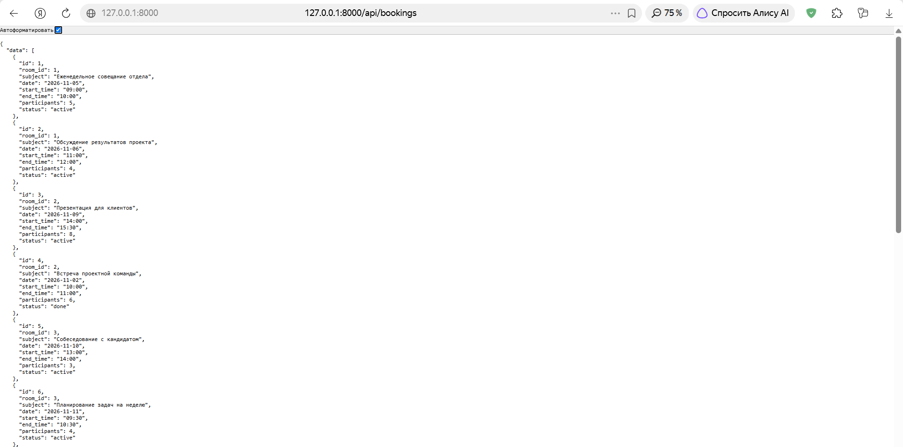
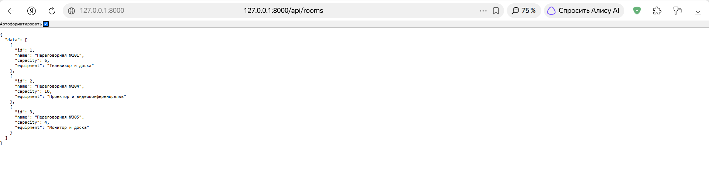
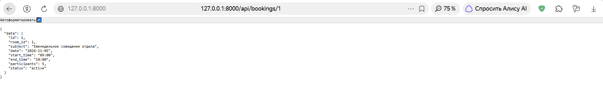
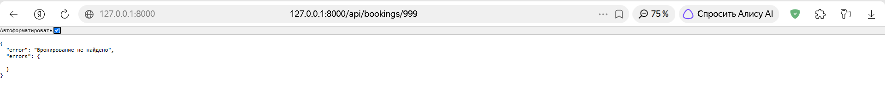

# Лабораторная работа №7

## Проектирование REST API

**Предметная область:** система бронирования переговорных комнат.

## Цель работы

Изучить принципы проектирования REST API, разработать набор ресурсов информационной системы, реализовать основные HTTP-методы, подготовить документацию API и выполнить тестирование запросов.

## Описание приложения

В рамках лабораторной работы разработан REST API для системы бронирования переговорных комнат. За основу взята серверная часть приложения из лабораторной работы №6.

API позволяет работать с тремя видами ресурсов:

- бронирования;
- переговорные комнаты;
- пользователи.

Для обмена данными используется формат JSON. Информация хранится в JSON-файлах на сервере.

## Реализованные маршруты

### Бронирования

| Метод | Адрес | Назначение |
|---|---|---|
| GET | `/api/bookings` | Получение списка бронирований |
| GET | `/api/bookings/{id}` | Получение бронирования по ID |
| POST | `/api/bookings` | Создание бронирования |
| PUT | `/api/bookings/{id}` | Изменение бронирования |
| PATCH | `/api/bookings/{id}` | Частичное изменение бронирования |
| DELETE | `/api/bookings/{id}` | Удаление бронирования |

Для списка бронирований предусмотрена фильтрация по статусу и идентификатору переговорной комнаты.

### Переговорные комнаты

| Метод | Адрес | Назначение |
|---|---|---|
| GET | `/api/rooms` | Получение списка комнат |
| GET | `/api/rooms/{id}` | Получение комнаты по ID |
| POST | `/api/rooms` | Создание комнаты |
| PUT | `/api/rooms/{id}` | Изменение комнаты |
| PATCH | `/api/rooms/{id}` | Частичное изменение комнаты |
| DELETE | `/api/rooms/{id}` | Удаление комнаты |

### Пользователи

| Метод | Адрес | Назначение |
|---|---|---|
| GET | `/api/users` | Получение списка пользователей |
| GET | `/api/users/{id}` | Получение пользователя по ID |
| POST | `/api/users` | Создание пользователя |
| PUT | `/api/users/{id}` | Изменение пользователя |
| PATCH | `/api/users/{id}` | Частичное изменение пользователя |
| DELETE | `/api/users/{id}` | Удаление пользователя |

## Обработка данных

Для обработки запросов используются контроллеры, а для работы с данными — репозитории.

При создании и изменении бронирований проверяются:

- наличие темы встречи;
- существование переговорной комнаты;
- корректность даты и времени;
- количество участников и вместимость комнаты;
- отсутствие пересечений с другими активными бронированиями;
- допустимость статуса бронирования.

При обнаружении ошибок API возвращает JSON с описанием проблемы.

Используются HTTP-коды:

- `200 OK` — успешное получение или изменение данных;
- `201 Created` — создание ресурса;
- `204 No Content` — успешное удаление;
- `400 Bad Request` — некорректный запрос;
- `404 Not Found` — ресурс не найден;
- `422 Unprocessable Content` — ошибка проверки данных.
- `409 Conflict` — операция невозможна из-за конфликта с существующими данными, например при попытке удалить переговорную комнату, для которой есть бронирования.

## Запуск приложения

Для запуска необходим установленный PHP.

Из корневой папки проекта выполнить:

```powershell
cd lab7/src
php -S 127.0.0.1:8000 -t public
```

После запуска API доступен по адресу:

`http://127.0.0.1:8000/api/`

Например:

- `http://127.0.0.1:8000/api/bookings`
- `http://127.0.0.1:8000/api/rooms`
- `http://127.0.0.1:8000/api/users`

Для проверки запросов POST, PUT, PATCH и DELETE использовалась команда `Invoke-RestMethod` в PowerShell.

## Проверка работы API

### 1. Получение списка бронирований

Запрос `GET /api/bookings` возвращает JSON со списком бронирований.



### 2. Получение списка переговорных комнат

Запрос `GET /api/rooms` возвращает сведения о комнатах, их вместимости и оборудовании.



### 3. Получение отдельного бронирования

Запрос `GET /api/bookings/1` возвращает информацию о бронировании с идентификатором 1.



### 4. Обработка ошибки 404

При обращении к несуществующему бронированию `GET /api/bookings/999` возвращается сообщение об ошибке в формате JSON.



### 5. Проверка изменения и удаления данных

С помощью PowerShell также проверена работа запросов на создание, изменение и удаление ресурсов.

При создании нового бронирования API возвращает данные созданной записи. При изменении сохраняются новые значения полей. После удаления обращение к удалённому ресурсу возвращает ошибку 404.

Для пользователей проверены создание записи, изменение имени и удаление пользователя.

## Вывод

В ходе лабораторной работы разработан REST API для системы бронирования переговорных комнат на PHP. Реализованы маршруты для получения, создания, изменения и удаления ресурсов. Настроена передача данных в формате JSON, добавлены проверки пользовательского ввода и обработка ошибок с соответствующими HTTP-кодами. Работа API проверена через браузер и PowerShell.
