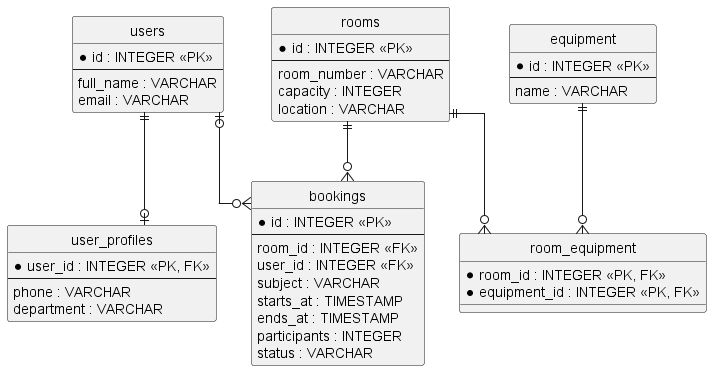

# Лабораторная работа №8

## Проектирование и реализация базы данных

СУБД: PostgreSQL 18.
Среда работы: pgAdmin 4.

## Цель работы
Изучить основы проектирования реляционных баз данных, разработать структуру базы данных PostgreSQL, реализовать связи между сущностями, выполнить основные операции по работе с данными и освоить базовые методы оптимизации SQL-запросов.

## Структура базы данных

В базе данных используются шесть таблиц:

- users — пользователи;
- user_profiles — профили пользователей;
- rooms — переговорные комнаты;
- equipment — оборудование;
- room_equipment — оборудование переговорных комнат;
- bookings — бронирования.

Связи между таблицами:

- users и user_profiles — один к одному;
- users и bookings — один ко многим;
- rooms и bookings — один ко многим;
- rooms и equipment — многие ко многим через room_equipment.

## ER-диаграмма

[Исходный код диаграммы](diagrams/src/er.puml)

## Целостность данных

В таблицах используются ограничения PRIMARY KEY, FOREIGN KEY,
UNIQUE, NOT NULL и CHECK.

Выполнено 9 проверок целостности данных, в том числе проверки
ограничений и действий CASCADE, RESTRICT и SET NULL.

[Проверка UNIQUE](images/01_integrity_unique_error.png)

[Результаты проверок](images/02_integrity_checks.png)

## Запросы к базе данных

Выполнены операции добавления, просмотра, изменения и удаления
записей, а также запросы с JOIN и GROUP BY.

- [INSERT](images/03_crud_insert.png)
- [SELECT и JOIN](images/04_crud_select_join.png)
- [UPDATE](images/05_crud_update.png)
- [DELETE](images/06_crud_delete.png)
- [Проверка удаления](images/07_crud_delete_check.png)
- [GROUP BY](images/08_group_by.png)

## Оптимизация запросов

Для проверки производительности в таблицу bookings добавлено
100 000 тестовых записей.

[Количество тестовых записей](images/09_test_data.png)

С помощью EXPLAIN ANALYZE проверены три запроса до и после
создания индексов.

| Запрос | До, мс | После, мс | Ускорение |
|---|---:|---:|---:|
| Поиск по дате начала | 4,058 | 0,075 | 54 раза |
| Поиск по названию | 4,580 | 0,054 | 85 раз |
| Сортировка по дате окончания | 85,118 | 0,036 | 2364 раза |

После создания индексов во всех трёх запросах используется
Index Scan. В третьем запросе также исчезла необходимость
в дополнительной сортировке.

Результаты EXPLAIN ANALYZE:

| Запрос | До оптимизации | После оптимизации |
|---|---|---|
| По дате начала | [Скриншот](images/10_starts_at_before.png) | [Скриншот](images/11_starts_at_after.png) |
| По названию | [Скриншот](images/12_subject_before.png) | [Скриншот](images/13_subject_after.png) |
| По дате окончания | [Скриншот](images/14_ends_at_before.png) | [Скриншот](images/15_ends_at_after.png) |

## Файлы проекта

- sql/01_schema.sql — создание таблиц и связей.
- sql/02_seed.sql — заполнение таблиц данными.
- sql/03_integrity.sql — проверка целостности данных.
- sql/04_crud.sql — запросы к базе данных.
- sql/05_test_data.sql — создание тестовых записей.
- sql/06_optimization.sql — оптимизация запросов.
- diagrams/ — ER-диаграмма и её исходный код.
- images/ — скриншоты выполнения запросов.