# Лабораторная работа № 9. Интеграция компонентов веб-приложения

## Цель работы

Объединить клиентскую и серверную части веб-приложения в единую систему: подключить клиент к REST API, реализовать аутентификацию и разграничение прав по ролям, пройти пользовательские сценарии работы и выполнить комплексное тестирование.

## 1. Описание приложения

Разрабатываемое приложение предназначено для бронирования переговорных комнат.

Основные возможности:

- просмотр переговорных комнат и бронирований;
- создание и отмена бронирований;
- поиск и фильтрация записей;
- проверка доступности и вместимости переговорных комнат;
- аутентификация пользователей;
- разграничение прав доступа.

## 2. Архитектура приложения

Приложение состоит из трёх основных частей:

| Компонент | Технологии | Назначение |
|---|---|---|
| Клиентская часть | HTML, CSS, JavaScript | Интерфейс пользователя и отправка HTTP-запросов |
| Серверная часть | PHP, REST API | Обработка запросов, проверка данных и прав доступа |
| База данных | PostgreSQL 18 | Хранение пользователей, комнат, бронирований и токенов |

Клиентская часть взаимодействует с сервером посредством HTTP-запросов с использованием Fetch API. Сервер обрабатывает запросы и обращается к базе данных через репозитории с использованием PDO.

Обмен данными осуществляется в формате JSON.

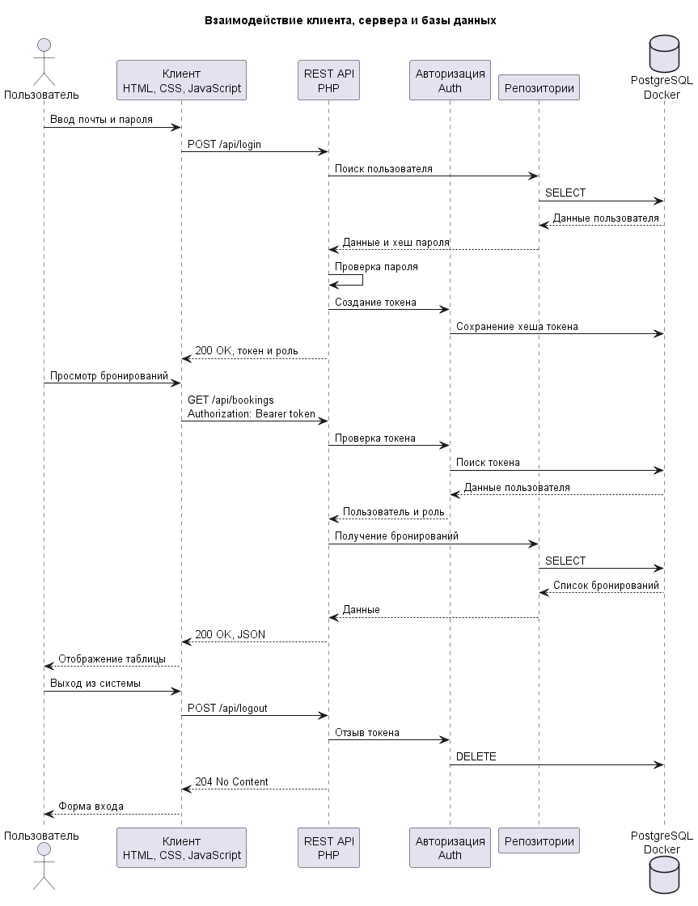

## 3. Интеграция компонентов

При объединении результатов предыдущих лабораторных работ были выполнены следующие изменения:

- заменены имитационные запросы клиентской части на обращения к REST API;
- согласованы названия полей и форматы передаваемых данных;
- реализована обработка ответов и ошибок сервера;
- заменено хранение данных в JSON-файлах на PostgreSQL;
- реализованы вход и выход из системы;
- добавлена передача токена в заголовках запросов;
- реализована проверка прав доступа;
- настроен запуск PostgreSQL с использованием Docker Compose;
- добавлен скрипт инициализации базы данных.

Примеры согласования клиента и сервера:

| Элемент | Реализация |
|---|---|
| Поля бронирования | Клиент передаёт `room_id`, `start_time`, `end_time` и другие поля в формате, который принимает API. |
| Получение списков | Клиент извлекает массив записей из поля `data` ответа сервера. |
| Поиск и фильтрация | Клиент передаёт параметры `q` и `status` в запросе `GET /api/bookings` с помощью URLSearchParams. |
| Аутентификация | Токен хранится в sessionStorage и передаётся в заголовке `Authorization: Bearer ...`. |
| Отмена бронирования | Клиент отправляет PATCH-запрос с полем `status` и значением `cancelled`, затем обновляет список. |
| Обработка ошибок | При ответе 401 открывается форма входа, при 403 и 422 отображаются сообщения сервера. Сетевые ошибки обрабатываются отдельно. |
| Выход | Ответ 204 обрабатывается без чтения JSON. Токен и данные интерфейса очищаются после выхода. |

## 4. Аутентификация и права доступа

При входе пользователь передаёт электронную почту и пароль. Сервер проверяет пароль и создаёт токен со сроком действия 2 часа.

Токен передаётся в заголовке Authorization при последующих запросах. В базе данных хранится хеш токена.

В системе предусмотрены две роли.

| Возможность | Пользователь | Администратор |
|---|---|---|
| Просмотр комнат | Да | Да |
| Просмотр бронирований | Да | Да |
| Создание бронирований | Да | Да |
| Изменение и удаление своих бронирований через API | Да | Да |
| Изменение и удаление чужих бронирований через API | Нет | Да |
| Управление комнатами через API | Нет | Да |
| Управление пользователями через API | Нет | Да |

Проверка токена и прав доступа выполняется на сервере. При выходе из системы токен отзывается.

## 5. Запуск приложения

Для запуска необходимы:

- PHP 8 с расширением pdo_pgsql;
- Docker и Docker Compose;
- веб-браузер.

Из корневого каталога репозитория необходимо перейти в каталог приложения:

```bash
cd lab9/src
```

Запустить PostgreSQL:

```bash
docker compose up -d
```

Проверить состояние контейнера:

```bash
docker compose ps
```

После перехода контейнера в состояние healthy выполнить инициализацию базы данных:

```bash
php bin/reset-db.php
```

Скрипт создаёт таблицы и заполняет их тестовыми данными. При повторном запуске существующие данные учебной базы удаляются.

Запустить PHP-сервер:

```bash
php -S 127.0.0.1:8000 -t public
```

Открыть приложение в браузере:

http://127.0.0.1:8000/client/

Тестовые учётные записи:

| Роль | Электронная почта | Пароль |
|---|---|---|
| Администратор | anna@example.com | 123456 |
| Пользователь | ivan@example.com | 123456 |

## 6. Работа приложения

### 6.1. Вход в систему

Пользователь вводит электронную почту и пароль.

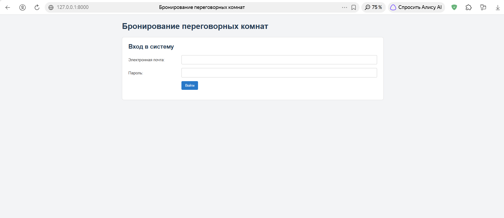

При вводе неверного пароля отображается сообщение об ошибке.

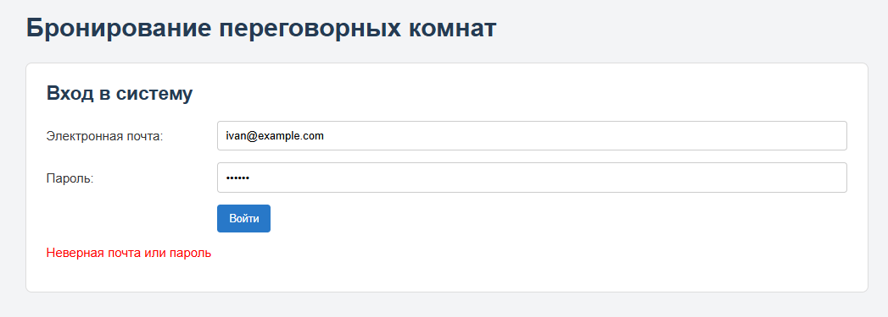

### 6.2. Просмотр бронирований

После аутентификации пользователь получает список бронирований из базы данных.

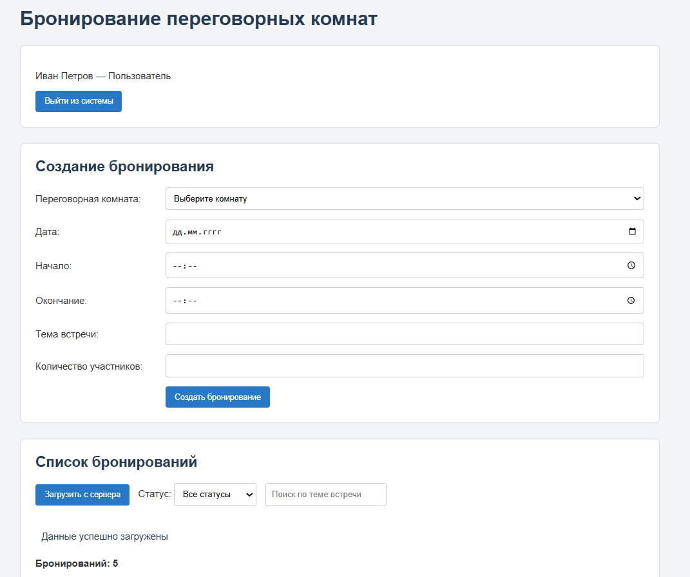

Обычный пользователь может отменять только собственные бронирования.

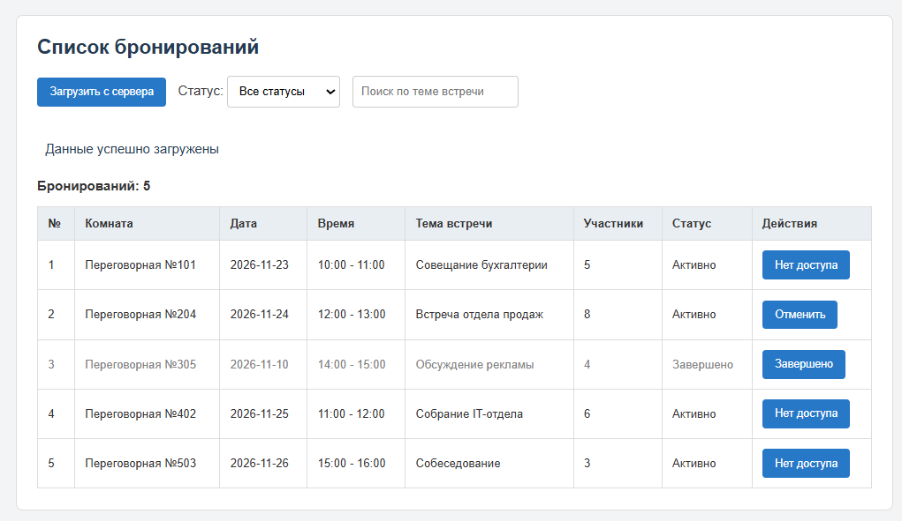

Администратор может отменять активные бронирования всех пользователей.

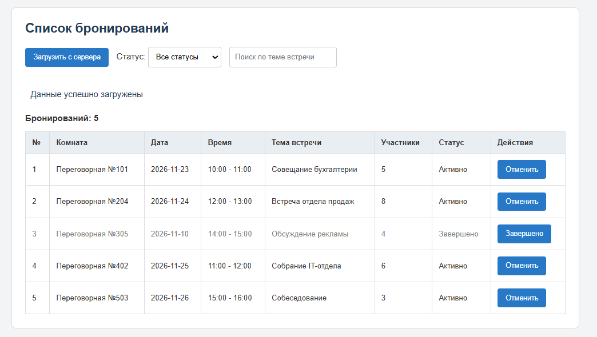

### 6.3. Создание бронирования

Пользователь выбирает переговорную комнату, указывает тему встречи, дату, время и количество участников.

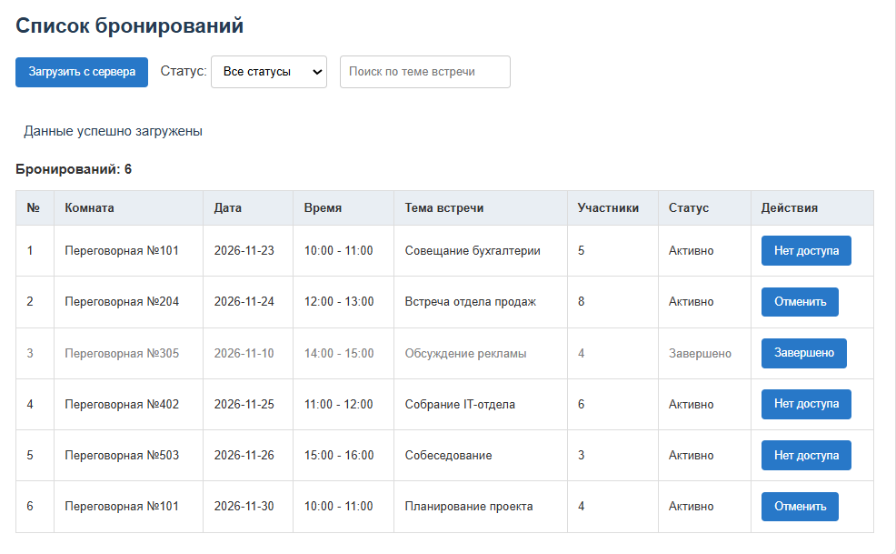

При попытке забронировать занятую комнату сервер возвращает ошибку.

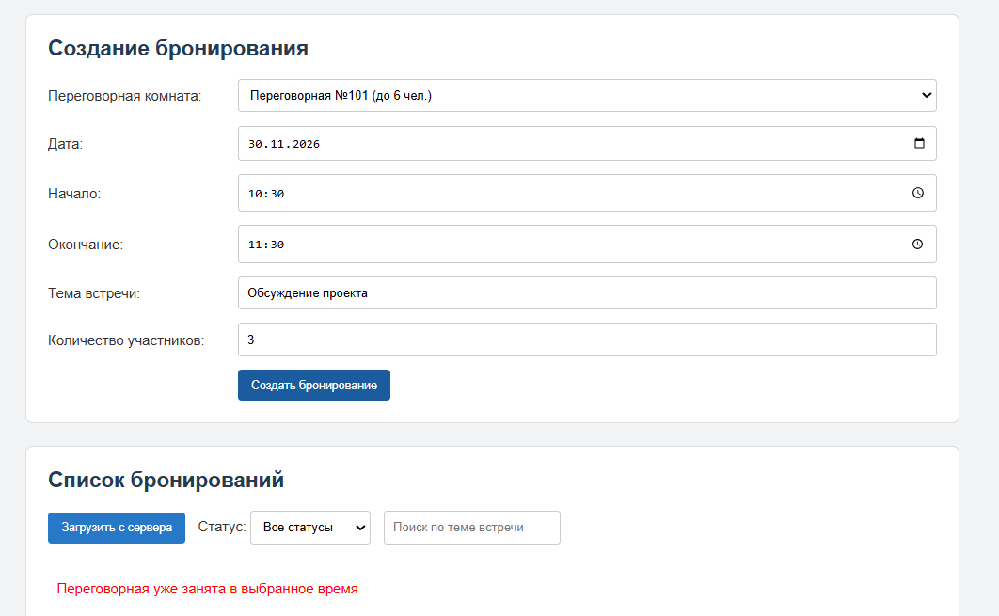

### 6.4. Отмена бронирования

При отмене бронирования его статус изменяется на cancelled.

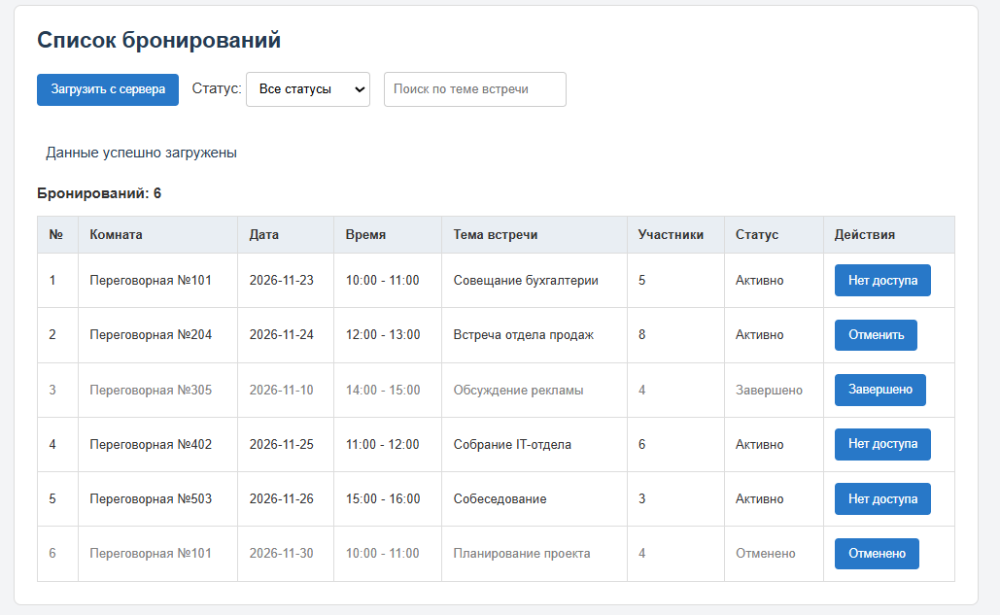

### 6.5. Поиск и фильтрация

Реализован поиск бронирований по теме встречи.

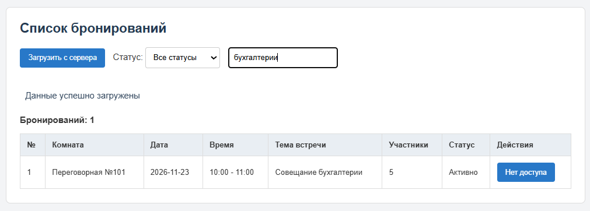

Также доступна фильтрация по статусу.

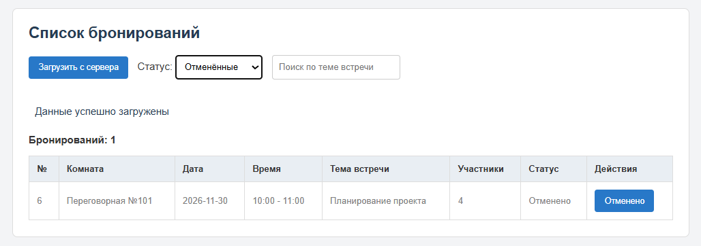

### 6.6. Проверка прав доступа

При попытке управления чужим бронированием обычный пользователь получает ответ 403 Forbidden.

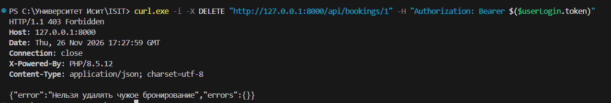

Получение списка пользователей также недоступно обычному пользователю.

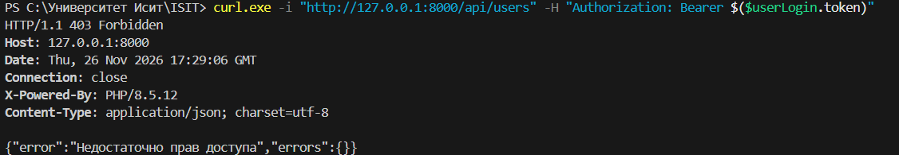

### 6.7. Выход из системы

При выходе из системы сервер отзывает токен и возвращает ответ 204 No Content.

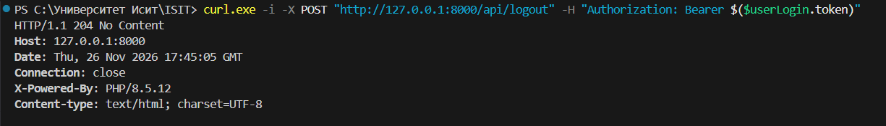

Пользователь возвращается к форме входа.

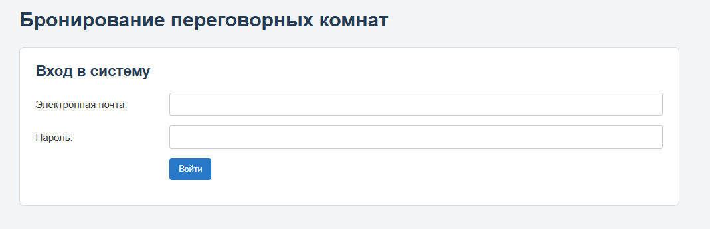

Повторное использование отозванного токена приводит к ответу 401 Unauthorized.

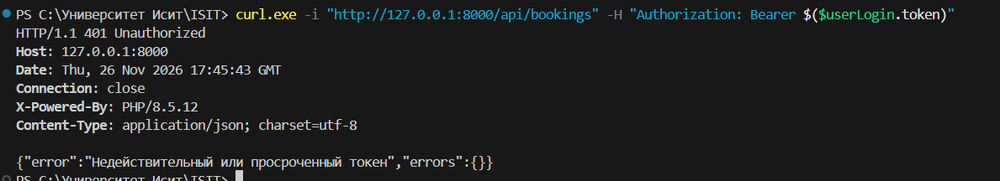

## 7. Тестирование

Проведено автоматизированное и ручное тестирование приложения, включая проверку безопасности.

| Вид тестирования | Всего проверок | Пройдено | Не пройдено |
|---|---:|---:|---:|
| Автоматизированные тесты REST API | 26 | 26 | 0 |
| Сквозные пользовательские сценарии | 15 | 15 | 0 |
| Проверки безопасности | 9 | 9 | 0 |

Часть проверок безопасности входит в состав автоматизированных тестов.

### Автоматизированное тестирование

Для запуска тестов необходимо при работающем PHP-сервере выполнить из каталога lab9/src:

```bash
php tests/api-tests.php
```

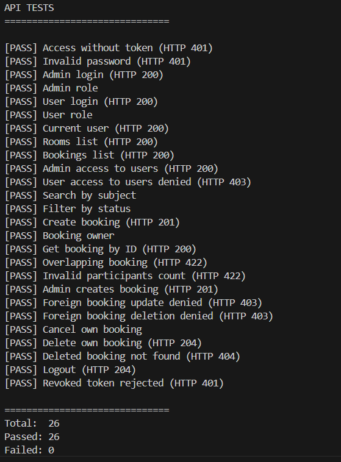

### Проверка сетевых ошибок

При потере соединения приложение выводит сообщение о недоступности сервера. После восстановления соединения данные можно загрузить повторно без входа в систему.

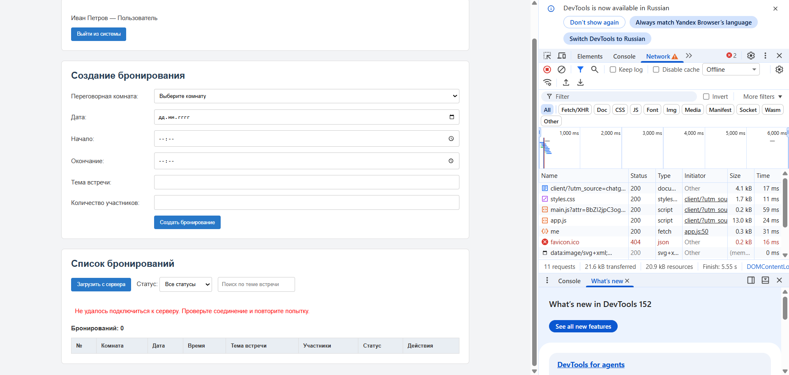

### Проверка безопасности

При истечении срока действия токена пользователь возвращается к форме входа.

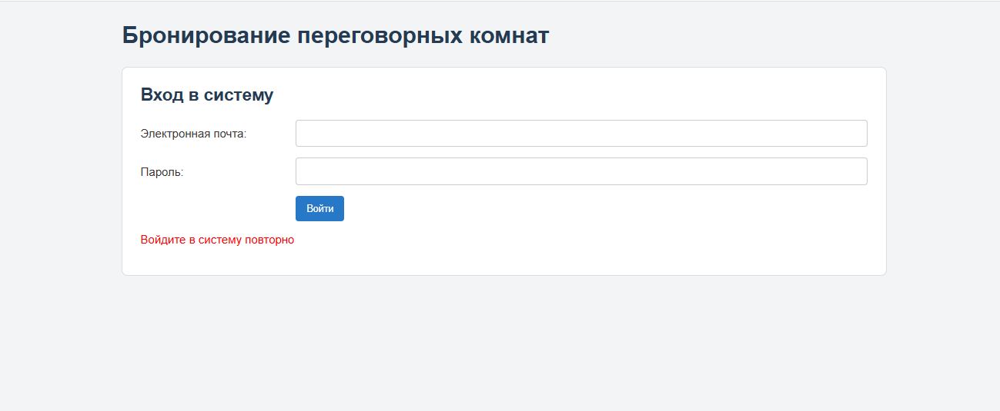

Для защиты от SQL-инъекций используются подготовленные запросы PDO с параметрами. При проверке поиска тестовая строка была обработана как обычный текст.

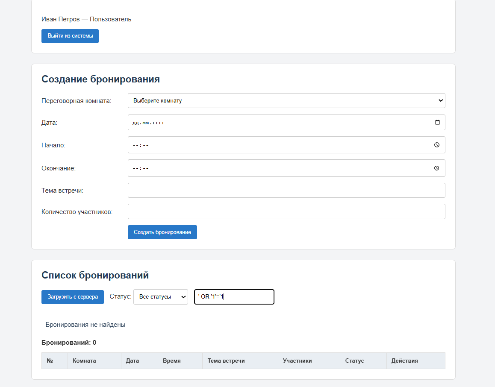

Для безопасного отображения пользовательских данных применяется свойство textContent. HTML-код в теме встречи отображается как обычный текст.


Подробные результаты представлены в [документации тестирования](docs/testing.md).

После завершения тестирования исходные данные восстанавливаются командой:

```bash
php bin/reset-db.php
```

## 8. Задание повышенной сложности

Реализован журнал входов в систему.

В файл storage/login.log записываются время попытки входа, электронная почта и результат аутентификации.

Пароли и токены в журнале не сохраняются. Файл журнала исключён из системы контроля версий.

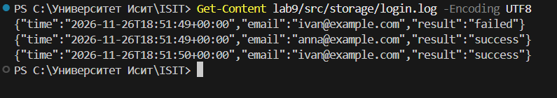

## 9. Подготовка к эксплуатации

Для использования приложения вне учебной среды необходимо:

- настроить HTTPS;
- заменить тестовые пароли и задавать параметры подключения к базе данных через переменные окружения;
- отключить режим отладки;
- реализовать миграции базы данных;
- ограничить количество неуспешных попыток входа;
- настроить централизованное журналирование и ротацию журналов;
- обеспечить защиту от одновременного создания пересекающихся бронирований.

## 10. Дополнительные материалы

- [Документация REST API](docs/api.md)
- [Результаты тестирования](docs/testing.md)
- [Исходный код диаграммы взаимодействия](diagrams/integration.puml)

## Вывод

В ходе лабораторной работы выполнена интеграция клиентской части, REST API и базы данных PostgreSQL. Реализованы аутентификация, разграничение прав доступа и журналирование попыток входа. Настроен запуск базы данных в Docker. Проведено ручное и автоматизированное тестирование. Все 26 автоматизированных проверок завершились успешно.
