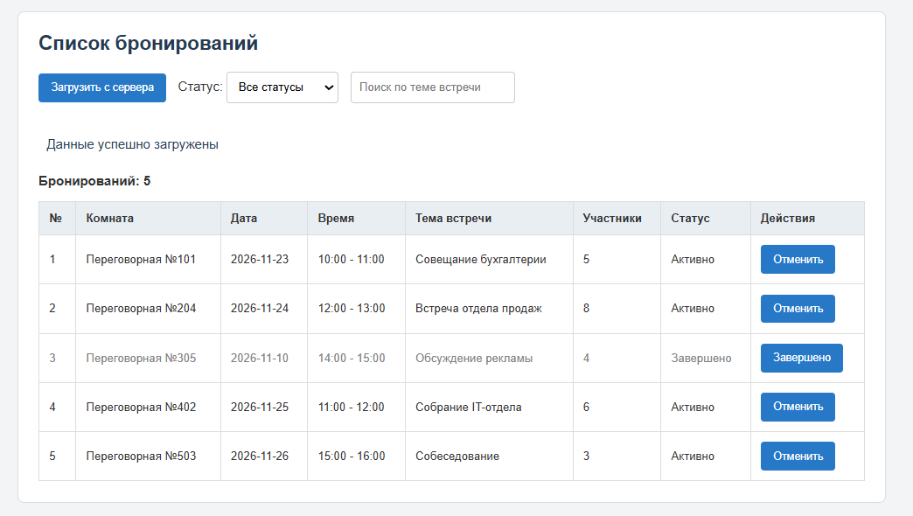
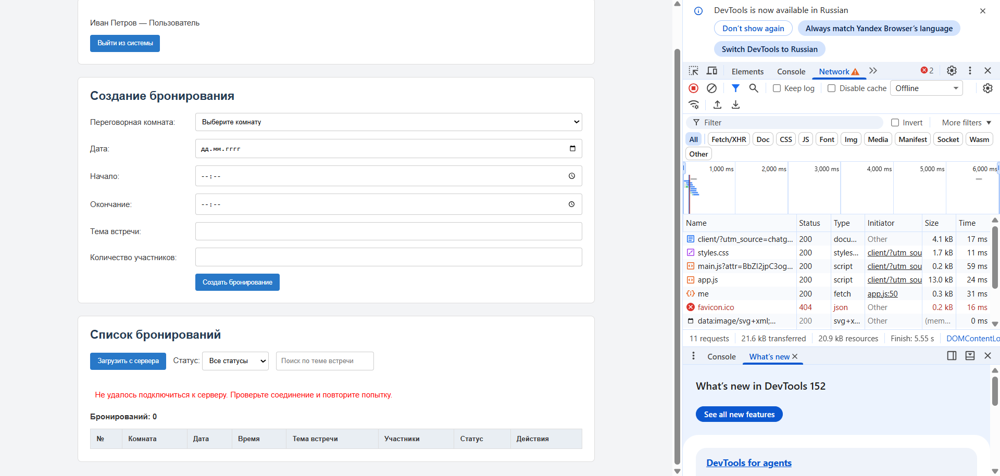
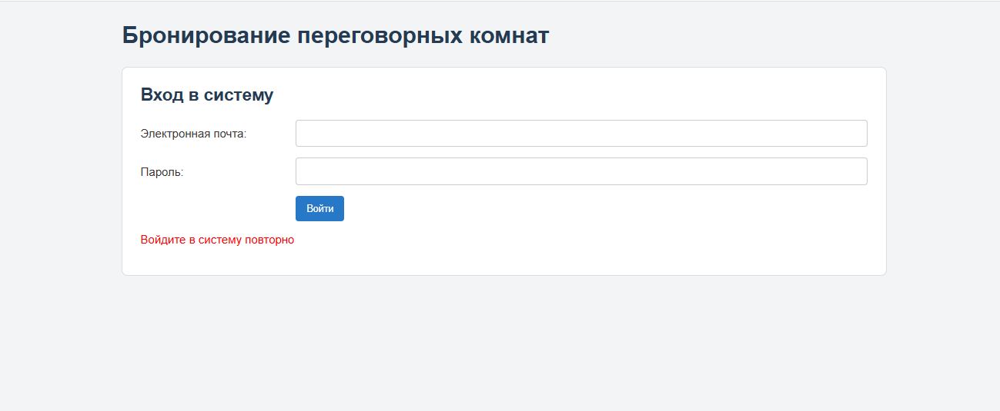
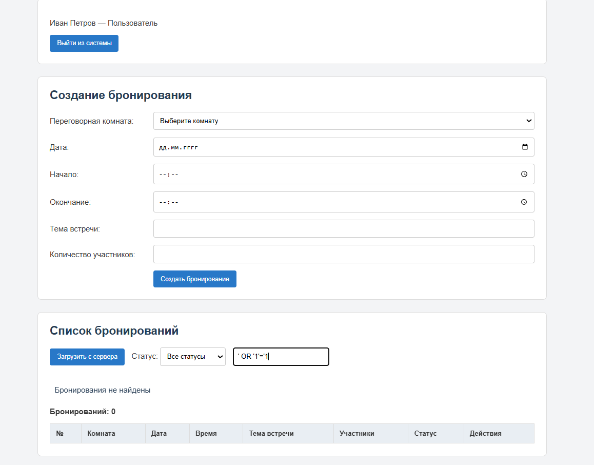
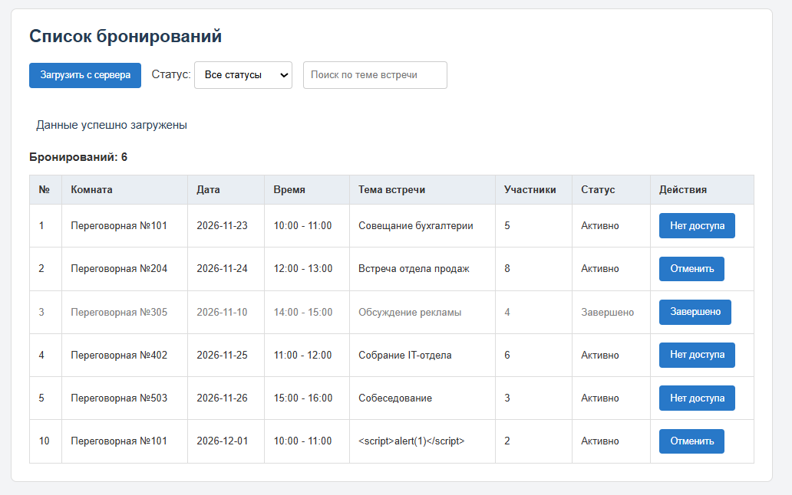
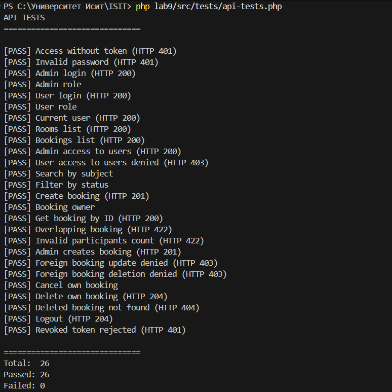
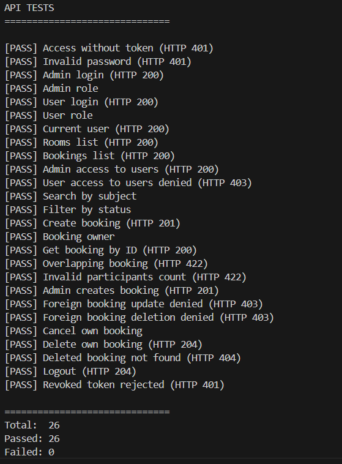
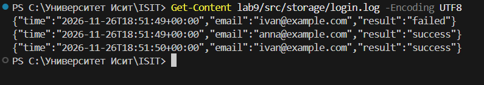

# Тестирование системы бронирования переговорных комнат

## 1. Условия тестирования

Тестирование проводилось после интеграции клиентской части, REST API и базы данных PostgreSQL.

Используемые средства:

- PHP;
- PostgreSQL 18;
- Docker Compose;
- браузер;
- автоматизированный скрипт tests/api-tests.php.

Для проверки использовались две учётные записи:

| Электронная почта | Пароль | Роль |
|---|---|---|
| anna@example.com | 123456 | admin |
| ivan@example.com | 123456 | user |


## 2. Ручное тестирование

### 2.1. Сквозные пользовательские сценарии

| № | Сценарий | Ожидаемый результат | Итог |
|---|---|---|---|
| 1 | Вход администратора | Отображение интерфейса администратора | PASS |
| 2 | Вход обычного пользователя | Отображение интерфейса пользователя | PASS |
| 3 | Вход с неверным паролем | Сообщение об ошибке | PASS |
| 4 | Загрузка переговорных комнат | Получение списка комнат | PASS |
| 5 | Загрузка бронирований | Отображение записей из базы данных | PASS |
| 6 | Создание бронирования | Появление новой записи в таблице | PASS |
| 7 | Бронирование занятой комнаты | Сообщение о пересечении встреч | PASS |
| 8 | Отмена бронирования | Изменение статуса на cancelled | PASS |
| 9 | Обновление страницы | Сохранение данных и авторизации | PASS |
| 10 | Поиск по теме встречи | Отображение соответствующих записей | PASS |
| 11 | Фильтрация по статусу | Отображение записей выбранного статуса | PASS |
| 12 | Выход из системы | Возврат к форме входа | PASS |
| 13 | Потеря соединения | Сообщение о недоступности сервера | PASS |
| 14 | Восстановление соединения | Повторная загрузка данных | PASS |
| 15 | Истечение срока действия токена | Возврат к форме входа | PASS |

Все 15 сквозных сценариев выполнены успешно.





### 2.2. Проверки безопасности

| № | Проверка | Ожидаемый результат | Итог |
|---|---|---|---|
| 1 | Запрос без токена | HTTP 401 | PASS |
| 2 | Вход с неверным паролем | HTTP 401 | PASS |
| 3 | Изменение чужого бронирования | HTTP 403 | PASS |
| 4 | Удаление чужого бронирования | HTTP 403 | PASS |
| 5 | Доступ пользователя к списку пользователей | HTTP 403 | PASS |
| 6 | Использование отозванного токена | HTTP 401 | PASS |
| 7 | Использование просроченного токена | Возврат к форме входа | PASS |
| 8 | SQL-инъекция в поисковой строке | Строка обрабатывается как текст | PASS |
| 9 | XSS в теме бронирования | HTML-код отображается как текст | PASS |

Для предотвращения SQL-инъекций используются подготовленные SQL-запросы с параметрами.

При выводе данных в клиентской части используется свойство textContent, предотвращающее интерпретацию темы бронирования как HTML-кода.







Все 9 указанных проверок безопасности пройдены. Часть проверок также входит в автоматизированные тесты REST API.

### Интерфейс администратора


## 3. Автоматизированное тестирование

Для проверки REST API разработан скрипт `src/tests/api-tests.php`.

Скрипт отправляет HTTP-запросы к серверу, проверяет коды ответов и содержимое полученных данных.

| № | Проверка | Ожидаемый результат | Фактический результат | Итог |
|---|---|---|---|---|
| 1 | Запрос без токена | 401 | 401 | PASS |
| 2 | Вход с неверным паролем | 401 | 401 | PASS |
| 3 | Вход администратора | 200 | 200 | PASS |
| 4 | Проверка роли администратора | admin | admin | PASS |
| 5 | Вход пользователя | 200 | 200 | PASS |
| 6 | Проверка роли пользователя | user | user | PASS |
| 7 | Получение текущего пользователя | 200 | 200 | PASS |
| 8 | Получение списка комнат | 200 | 200 | PASS |
| 9 | Получение списка бронирований | 200 | 200 | PASS |
| 10 | Доступ администратора к списку пользователей | 200 | 200 | PASS |
| 11 | Доступ обычного пользователя к списку пользователей | 403 | 403 | PASS |
| 12 | Поиск по теме встречи | Найдена нужная запись | Найдена нужная запись | PASS |
| 13 | Фильтрация по статусу | Только активные записи | Только активные записи | PASS |
| 14 | Создание бронирования | 201 | 201 | PASS |
| 15 | Проверка владельца бронирования | ID текущего пользователя | ID текущего пользователя | PASS |
| 16 | Получение бронирования по ID | 200 | 200 | PASS |
| 17 | Создание пересекающегося бронирования | 422 | 422 | PASS |
| 18 | Превышение вместимости комнаты | 422 | 422 | PASS |
| 19 | Создание бронирования администратором | 201 | 201 | PASS |
| 20 | Изменение чужого бронирования пользователем | 403 | 403 | PASS |
| 21 | Удаление чужого бронирования пользователем | 403 | 403 | PASS |
| 22 | Отмена собственного бронирования | 200, cancelled | 200, cancelled | PASS |
| 23 | Удаление собственного бронирования | 204 | 204 | PASS |
| 24 | Получение удалённого бронирования | 404 | 404 | PASS |
| 25 | Выход из системы | 204 | 204 | PASS |
| 26 | Использование отозванного токена | 401 | 401 | PASS |

## 4. Запуск автоматизированных тестов

Из каталога lab9/src при работающем PHP-сервере необходимо выполнить команду:

```bash
php tests/api-tests.php
```

Результат тестирования:

| Показатель | Значение |
|---|---:|
| Всего проверок | 26 |
| Успешно пройдено | 26 |
| Не пройдено | 0 |
| Доля успешных проверок | 100% |

### Результаты тестирования с локальной базой данных



### Результаты тестирования с PostgreSQL в Docker



## 5. Проверка задания повышенной сложности

В качестве задания повышенной сложности реализован журнал входов.

В файл storage/login.log записываются дата и время, электронная почта и результат попытки входа.

Проверены успешная авторизация и авторизация с неверным паролем. В обоих случаях соответствующие записи появились в журнале.

Пароли и токены не сохраняются.



После добавления журналирования повторно выполнены все 26 автоматизированных тестов. Все проверки пройдены.

## 6. Вывод

В ходе тестирования проверены взаимодействие клиента и сервера, получение данных из PostgreSQL, авторизация, разграничение прав доступа и основные операции с бронированиями.

Все 26 автоматизированных проверок завершились успешно. Работоспособность приложения подтверждена как с локальной базой данных, так и с PostgreSQL, запущенным в Docker.
